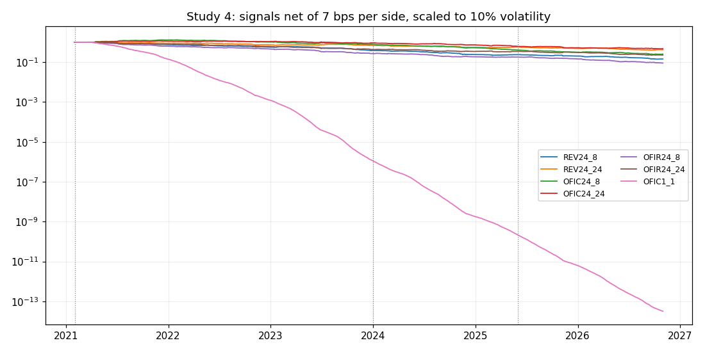

# Study 4 results: short-horizon crypto signals with order flow (2026-11-07)

Protocol: [`../docs/preregistration_study4_2026-11-07.md`](../docs/preregistration_study4_2026-11-07.md)
(committed 15:46 CET, before any test). Code: `fetch_holdout.py`, `study4.py`.

## Summary

- **No signal is profitable after realistic costs** (7 bps per side). No candidate.
- **There is a real gross edge:** 1-hour order-flow continuation (OFIC1_1: long the coins
  most aggressively bought in the last hour, short the most sold) has a gross Sharpe of
  1.18, 0.65 and 0.92 in Selection, Confirmation and the 2025-26 holdout, above the
  placebo noise band.
- **It is untradeable at retail costs.** The book turns over about 13,000 times a year;
  the break-even cost is **0.1 to 0.2 bps per side**, ten to twenty times below a maker
  fee. This edge belongs to market makers with fee rebates and co-location.

## Engine checks (before results)

All passed: no look-ahead in any score; one-bar execution lag (targets at t earn from
t+2); books dollar-neutral with gross 1; placebo with shuffled scores gives a Sharpe of
-0.06 on average (five draws between -0.36 and +0.55). The placebo spread is the noise
band: a Sharpe below about 0.5 over this sample is indistinguishable from luck.

## Sharpe ratio by period

| signal | gross Sel / Conf / Hold | at 7 bps Sel / Conf / Hold | turnover /yr |
|---|---|---|---|
| OFIC1_1 (1h flow, hourly) | **1.18 / 0.65 / 0.92** | -34 / -55 / -58 | ~13,000x |
| OFIC24_8 | 1.77 / -0.77 / 0.92 | -0.17 / -3.96 / -2.77 | ~850x |
| OFIC24_24 | 0.72 / -0.73 / 0.48 | -0.40 / -2.64 / -1.72 | ~490x |
| OFIR24_8 | -1.78 / 0.78 / -0.93 | -3.75 / -2.41 / -4.66 | ~850x |
| OFIR24_24 | -0.70 / 0.74 / -0.48 | -1.82 / -1.17 / -2.68 | ~490x |
| REV24_8 | -1.08 / 0.41 / 0.09 | -3.17 / -2.24 / -2.88 | ~990x |
| REV24_24 | 0.20 / 0.73 / -0.12 | -1.00 / -0.89 / -1.78 | ~560x |

Break-even cost per side (gross return / turnover):

| signal | Selection | Confirmation | Holdout |
|---|---|---|---|
| OFIC1_1 | 0.23 bps | 0.08 bps | 0.11 bps |
| OFIC24_24 | 4.42 bps | negative | 1.52 bps |
| REV24_24 | 1.04 bps | 3.15 bps | negative |

The 24-hour signals flip sign between periods (order flow continuation in 2021-23 and
2025-26, reversal in 2024-25), so even at zero cost they are not reliable. Full table
with all four cost levels: [`metrics.csv`](metrics.csv).

## Conclusion

Short-horizon order flow carries information, consistently, but at a horizon and
turnover where only near-zero-cost execution can harvest it. For a retail account the
answer is "no short-horizon edge after costs", as pre-registered.
