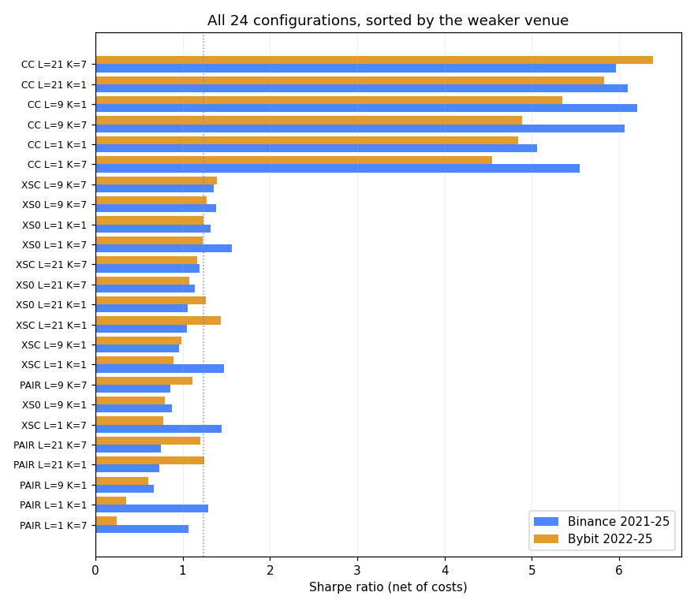
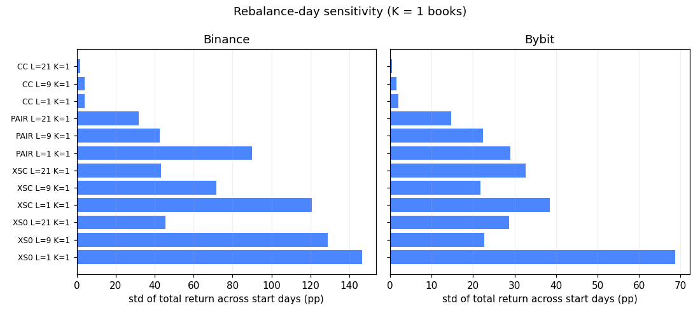
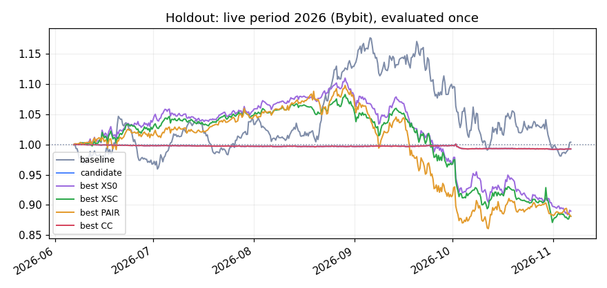
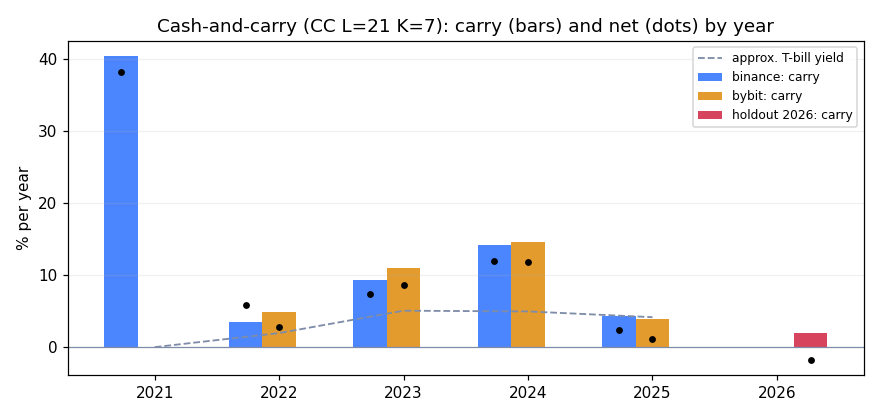

# Funding-carry improvement study: results (2026-11-07)

Protocol: [`../preregistration_2026-11-07.md`](../preregistration_2026-11-07.md), committed
(14:13 CET) and pushed **before** any test was run. Code: `quantresearch/carry_lab.py`
(engine), `scripts/eval_improvements.py` (study), `scripts/eval_cc_robustness.py`
(post-hoc checks), `scripts/fetch_improvement_data.py` (data).

## Summary

1. **The cross-sectional book cannot be fixed by better weights, hedges, signals or
   tranches.** No single change beats the baseline on both venues. The best combination
   inside that family beats it in-sample by a hair (+0.03 / +0.16 Sharpe) and then loses
   11.9% on the 2026 holdout, against +0.4% for the baseline.
2. **Smoothing the signal and tranching make results far less dependent on the rebalance
   day** (schedule spread falls from 147 to 46 percentage points on Binance), but they do
   not reliably raise the Sharpe ratio.
3. **Cash-and-carry wins by a wide margin in 2021 to 2025** (Sharpe 6.0 Binance, 6.4 Bybit;
   volatility 1 to 2%; max drawdown under 2.5%). It passes the robustness rule (R3) and has a
   deflated Sharpe ratio of 0.994.
4. **But its return is entirely a funding regime.** Carry was 40% in 2021 and 14 to 15% in
   2024, but 4% in 2025 (below the cash yield) and 2% in the 2026 holdout (below costs):
   the holdout lost 0.74%. On monthly returns the Sharpe is 2.2 to 2.9, not 6.
5. **Decision (rule R6):** the candidate runs as a third live shadow ledger from
   2026-11-07 16:00 UTC. The honest expectation in the current regime is roughly flat
   after costs.

## Validation (before any result was read)

The new engine reproduces `scripts/eval_hedge_variants.py` exactly:

| | Binance baseline | Binance C | Bybit baseline | Bybit C |
|---|---|---|---|---|
| reference | 1.320 | 1.478 | 1.237 | 0.900 |
| new engine | 1.320 | 1.478 | 1.237 | 0.900 |

Getting there exposed a real property of the data. **51% of Bybit funding prints are
exactly 0.01%** (the default rate), and in **70 of 148 rebalances the boundary of a leg
falls inside such a tie.** Which coins enter the book then depends on the order of the
coin list. The first version of the engine broke ties differently (unstable sort) and
diverged; it now breaks ties by column order like the original. This arbitrariness is
part of why the cross-sectional book is so sensitive to the rebalance day.

A second fix: Binance spot dumps switched from millisecond to microsecond timestamps in
January 2025, which the loader did not handle for multi-year frames.
`binance_loader._to_datetime` now detects the unit per row (perp data is unchanged).

## Configurations

24 per venue (48 trials): signal L in {latest, 3-day mean, 7-day mean} x tranches K in
{1, 7} x construction in {XS0 baseline, XSC inverse-vol + BTC/ETH, PAIR correlation pairs,
CC cash-and-carry}. Costs 8 bps per leg turnover. Full table: [`grid.csv`](grid.csv),
ranking: [`ranking.csv`](ranking.csv).

## R1: each change on its own (Sharpe vs baseline)

| change | Binance | Bybit |
|---|---|---|
| signal: 3-day mean (L=9) | -0.45 | -0.44 |
| signal: 7-day mean (L=21) | -0.26 | +0.03 |
| 7 tranches (K=7) | +0.24 | -0.01 |
| inverse vol + BTC/ETH hedge (XSC) | +0.16 | -0.34 |
| correlation pairs (PAIR) | -0.02 | -0.88 |
| **cash-and-carry (CC)** | **+3.74** | **+3.61** |

Only cash-and-carry improves on both venues.

## Selected configurations

| | Binance Sharpe | Bybit Sharpe | return /yr (Bn / By) | vol | max DD |
|---|---|---|---|---|---|
| baseline XS0 L=1 K=1 | 1.32 | 1.24 | 42.3% / 32.3% | 30% / 25% | -32% / -23% |
| best cross-sectional: XSC L=9 K=7 | 1.35 | 1.40 | 29.4% / 25.9% | 21% / 18% | -26% / -23% |
| **candidate: CC L=21 K=7** | **5.96** | **6.39** | 15.1% / 8.2% | 2.4% / 1.2% | -2.3% / -0.8% |

- R2 (maximin): CC L=21 K=7, no tie.
- R3 (beats baseline on both venues): **passed**.
- R5 deflated Sharpe ratio (Bybit, 48 trials): candidate **0.994** (threshold Sharpe under
  the null 4.5 annualised), baseline 0.000. Caveat: the null threshold uses the variance
  of Sharpe across all trials, which the gap between the CC family and the rest makes
  large. That is conservative for the candidate but makes the baseline's DSR meaningless.

## Rebalance-day sensitivity

Spread (standard deviation) of the final cumulative return across the 7 possible start
days, for K=1 books, in percentage points. Full table: [`schedule.csv`](schedule.csv).

| | Binance | Bybit |
|---|---|---|
| XS0 L=1 (baseline) | 146.5 | 68.7 |
| XS0 L=21 | 45.7 | 28.6 |
| PAIR L=21 | 31.9 | 14.7 |
| CC L=21 | 1.7 | 0.4 |

On the 2026 holdout the baseline's 21 possible schedules (7 days x 3 funding times) end
anywhere from **-32.2% to +31.0%** (median -9.2%). A single five-month live result of the
cross-sectional book says very little.

## R4: holdout (live period 6 June to 6 November 2026, Bybit, evaluated once)

| | config | Sharpe | total | vol | max DD | carry /yr |
|---|---|---|---|---|---|---|
| baseline | XS0 L=1 K=1 | 0.16 | +0.38% | 23.5% | -16.6% | 3.1% |
| **candidate** | **CC L=21 K=7** | **-1.50** | **-0.74%** | 1.2% | -0.9% | 2.0% |
| best XS0 | XS0 L=9 K=7 | -1.68 | -11.0% | 15.8% | -20.4% | 3.6% |
| best XSC | XSC L=9 K=7 | -1.82 | -11.9% | 15.9% | -19.6% | 4.2% |
| best PAIR | PAIR L=9 K=7 | -1.50 | -11.9% | 18.9% | -21.6% | 0.0% |

The engine's baseline result here (+0.4%) differs from the clean-schedule replay in the
paper (-4.8%) because the study engine uses a one-period execution lag, log returns and
8 bps costs. Both lie well inside the -32% to +31% schedule range above.

## Post-hoc robustness of the candidate (not pre-registered, does not change selection)

From [`cc_robustness.json`](cc_robustness.json):

| | Binance | Bybit | holdout 2026 |
|---|---|---|---|
| Sharpe on 8h returns | 5.96 | 6.39 | -1.50 |
| **Sharpe on monthly returns** | **2.21** | **2.89** | -1.59 |
| return /yr | 15.1% | 8.2% | -1.8% |
| approx. T-bill yield over the sample | 3.2% | 4.5% | n/a |
| **return above cash** | **11.9%** | **3.7%** | n/a |
| return with 0 / 8 / 16 / 24 bps costs | 17.6 / 15.1 / 12.6 / 10.2% | 11.1 / 8.2 / 5.3 / 2.5% | 1.7 / -1.8 / -5.1 / -8.4% |
| slots filled (positive funding) | 97% | 98% | 98% |

Carry and net return by calendar year:

| year | carry Bn | net Bn | carry By | net By | T-bill (approx.) |
|---|---|---|---|---|---|
| 2021 | 40.4% | 38.2% | | | 0.0% |
| 2022 | 3.6% | 5.9% | 5.0% | 2.9% | 2.0% |
| 2023 | 9.4% | 7.4% | 11.0% | 8.6% | 5.1% |
| 2024 | 14.1% | 12.0% | 14.6% | 11.9% | 5.0% |
| 2025 | 4.3% | 2.4% | 4.0% | 1.1% | 4.2% |
| 2026 (holdout) | | | 2.0% | -1.8% | |

Notes:
- The 8h Sharpe overstates because funding is persistent (autocorrelated); monthly
  returns give the more honest 2.2 to 2.9.
- Returns are per unit of spot notional. With separate spot and perp accounts capital
  roughly doubles and returns halve (Bybit: about 4%/yr, below the cash yield).
- T-bill yields are rounded approximate annual averages, used only for orders of
  magnitude.
- Not modelled: exchange and custody risk, auto-deleveraging, stablecoin risk, and the
  basis moving against the position intraperiod.

## Deviations from the protocol

None in the configurations, data splits, metrics or decision rules. Additions, all
labelled: the tie-breaking and timestamp fixes (made during validation, before results);
the post-hoc robustness section; the remark on the deflated Sharpe ratio's null.

## Conclusions and next steps

- The cross-sectional funding book is a dispersion bet; no reweighting, rehedging,
  smoothing or tranching turns it into a robust carry strategy.
- Cash-and-carry is the right construction for harvesting funding: it removes the
  dispersion risk almost completely. Its return is the funding regime itself, so it pays
  in leveraged bull markets (2021, 2023-24) and not otherwise.
- **Next hypothesis** (to be pre-registered separately, not tuned on these results):
  hold cash-and-carry only while the 7-day mean funding of the selected coins exceeds
  costs plus a cash yield, and hold cash or T-bills otherwise.
- The cash-and-carry shadow ledger (`scripts/forward_test_cc.py`, tests in
  `tests/test_forward_cc.py`) is now the real out-of-sample test.
