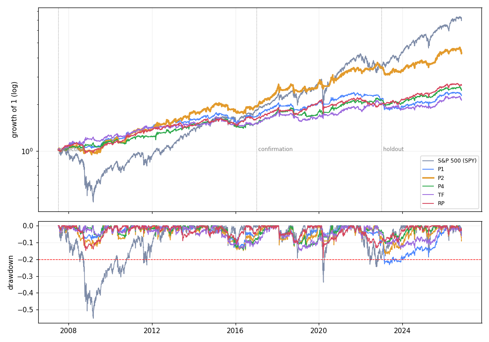

# Multi-asset portfolio study: results (2026-11-07)

Protocol: [`../docs/preregistration_2026-11-07.md`](../docs/preregistration_2026-11-07.md),
committed and pushed (15:19 CET) before any test. Code: `portfolio_lab.py`, `run_study.py`.

## Summary

- **No strategy beat the S&P 500's return within a 20% drawdown.** The candidate
  (P2: S&P + trend following, 50/50 risk) earned 7.8% a year from 2007-07 to 2026-11
  against 10.6% for SPY, with a maximum drawdown of -17% against -55%, and a slightly
  higher Sharpe ratio (0.61 vs 0.53).
- **Holdout 2023 to 2026 (evaluated once):** SPY +20.1%/yr, P2 +5.2%/yr. A strong equity
  bull market and a weak period for trend following (TF +1.1%/yr).
- **The prior expectation was too optimistic.** The pre-registration expected an excess
  Sharpe of 0.7 to 1.0; realised full-period Sharpe ratios were 0.35 to 0.64.

## Engine checks (before results)

All passed: BENCH equals SPY exactly; the fast path equals the reference implementation;
no look-ahead in TF, RP or SMA weights; a 10% volatility target realises 11.2%.
Two bugs were fixed during checks: an empty-universe crash in the first months, and a
check that compared the wrong dates.

## Calibration (target volatility with selection-period max drawdown <= 15%)

| SMA | RP | TF | TFL | P1 | P2 | P3 | P4 | P5 |
|---|---|---|---|---|---|---|---|---|
| 7% | 6% | 7% | 6% | 6% | 9% | 7% | 6% | 5% |

## Results

Full period 2007-07 to 2026-11 (metrics.csv has every period):

| strategy | CAGR | vol | Sharpe | max DD | worst year | positive years | corr SPY |
|---|---|---|---|---|---|---|---|
| BENCH (SPY) | 10.6% | 19.7% | 0.53 | -55.2% | -36.8% | 80% | 1.00 |
| SMA | 5.1% | 7.7% | 0.49 | -15.2% | -6.6% | 75% | 0.61 |
| RP | 5.2% | 7.0% | 0.55 | -19.1% | -9.6% | 80% | 0.68 |
| TF | 4.0% | 7.9% | 0.35 | -15.0% | -8.4% | 85% | 0.00 |
| TFL | 5.8% | 7.2% | 0.62 | -14.2% | -8.9% | 85% | 0.29 |
| P1 (RP+TF) | 4.4% | 7.5% | 0.41 | -23.3% | -10.3% | 70% | 0.39 |
| **P2 (SPY+TF)** | **7.8%** | 10.8% | **0.61** | **-17.1%** | -7.4% | 75% | 0.54 |
| P3 (RP+TF+BTC) | 5.4% | 8.4% | 0.49 | -22.9% | -13.9% | 70% | 0.38 |
| P4 (SMA+TF) | 4.8% | 7.7% | 0.45 | -14.5% | -7.9% | 80% | 0.31 |
| P5 (RP+TFL) | 5.4% | 6.2% | 0.64 | -12.8% | -7.5% | 85% | 0.50 |

### Decision rules

- **D1** (max DD <= 20% and Sharpe > SPY in both Selection and Confirmation):
  P2, P3, P4 qualify.
- **D2** (highest min(CAGR Selection, CAGR Confirmation)): **P2** (7.2%), then P3 (6.4%),
  P4 (4.4%).
- **D3 holdout 2023-01 to 2026-11:**

| | CAGR | Sharpe | max DD |
|---|---|---|---|
| SPY | 20.1% | 1.00 | -18.8% |
| P2 (candidate) | 5.2% | 0.11 | -11.1% |
| P3 | 0.4% | -0.42 | -17.6% |
| P4 | 3.7% | -0.09 | -8.4% |

- **D4:** the protocol starts the candidate as a monthly paper ledger. Given the holdout,
  this is the owner's call (see the vault note).

## Additional metrics proposed by the owner (reported, not used for selection)

Full period. PFd / PFm: profit factor on daily / monthly returns; Calmar = CAGR / |max DD|.

| strategy | PF daily | PF monthly | Sortino | Calmar |
|---|---|---|---|---|
| SPY | 1.13 | 1.71 | 0.66 | 0.19 |
| P2 | 1.15 | 1.94 | 0.77 | 0.45 |
| TF | 1.10 | 1.57 | 0.46 | 0.27 |
| P5 | 1.18 | 2.06 | 0.80 | 0.42 |

None reaches Sharpe > 1.2 or Calmar > 2 over 19 years (SPY: 0.53 and 0.19). Profit
factor depends on the unit: monthly most strategies exceed 1.5, daily nothing does.
Correlation near zero is achieved by TF (0.00).

## Interpretation

With a 20% drawdown limit, volatility must stay around 10%, so the return is roughly
cash + 10% x Sharpe. Beating SPY's 10.6% therefore needs a sustained Sharpe of about
0.65 or more; the best robust candidates here reach 0.61 to 0.64. The realistic choices
are: accept SPY-like returns with a third of its drawdown (P2 at ~11% vol), or accept a
25 to 30% drawdown for SPY-plus returns at half its drawdown (P2 at about SPY's volatility).
