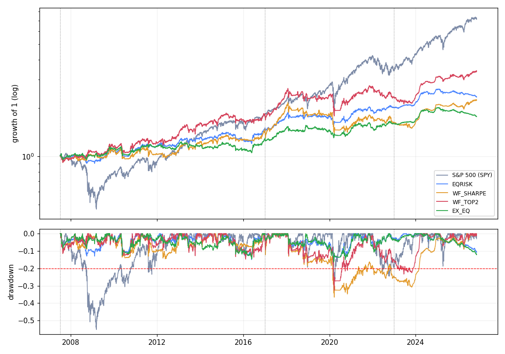

# Study 3 results: a portfolio of uncorrelated strategies (2026-11-07)

Protocol: [`../../docs/preregistration_study3_2026-11-07.md`](../../docs/preregistration_study3_2026-11-07.md)
(committed 15:37 CET, before any test). Code: `study3_data.py`, `study3.py`.

## Summary

- **No strategy met the pre-registered requirements** (max DD <= 20% and Sharpe above
  SPY in both Selection and Confirmation). There is no candidate.
- **The owner's hypothesis "use what worked recently" is not supported.** The
  recent-winner rule (WF_SHARPE) had a Sharpe of 0.17 in 2017-22 against 0.58 for equal
  risk, with a -37% drawdown; it did better in 2023-26 (0.66 vs -0.12). The rule needed
  both; it is a coin flip across regimes, consistent with the performance-chasing
  literature.
- **Diversification worked as a mechanism, but the ingredients were weak.** Sleeve
  correlations are low (-0.27 to +0.30), yet most sleeves have a Sharpe near zero over
  2007-2026: FX carry 0.02, FX trend -0.13, crypto cash-and-carry -0.06 (after cash).
  Combining near-zero streams gives a near-zero portfolio (equal risk: 0.43 vs SPY 0.54).

## Engine checks (before results)

All 12 passed, after one fix: sleeves without eligible instruments were first counted as
"started" with zero returns (NaN != 0 is True in pandas). A start-date check was added;
the sleeves now start when their data allows (FX carry 2004-04, crypto trend 2015-10,
cash-and-carry 2022-08).

## Sleeves, full period 2007-07 to 2026-10 (each scaled by the calibration rule)

| sleeve | CAGR | Sharpe | max DD | corr SPY | note |
|---|---|---|---|---|---|
| SPY (unscaled) | 10.7% | 0.54 | -55.2% | 1.00 | benchmark |
| EQ (SPY, vol-managed to 7%) | 6.2% | 0.59 | -18.2% | 0.89 | best risk-adjusted sleeve |
| ETF_TF | 4.0% | 0.34 | -14.2% | -0.03 | weak 2023-26 |
| FX_CARRY | 1.5% | 0.02 | -15.6% | 0.14 | flat 2007-22, strong 2023-26 (Sharpe 0.75) |
| FX_TF | 0.7% | -0.13 | -13.0% | -0.07 | no edge |
| CRYPTO_TF | 9.0% | 0.50 | -49.5% | 0.04 | from 2015; huge drawdown |
| CRYPTO_CC | 1.4% | -0.06 | -21.3% | 0.00 | from 2022-08; see note |

Note on CRYPTO_CC: absent in the Selection period, so the calibration rule picks the top
target (25%) and the 3x leverage cap binds. Its return is in excess of cash, and since
2025 cash-and-carry has earned less than T-bills (raw net return 2025 +0.6%, 2026 -2.5%),
so 3x leverage on a negative excess return gives the -21% drawdown. The raw series is
clean (worst day -0.54% on 2025-02-21, the day of the Bybit hack, reversed the next day).

Sleeve correlations (2007-2026): [`sleeve_correlations.csv`](sleeve_correlations.csv).

## Combinations

| | full CAGR | full Sharpe | full max DD | Confirmation Sharpe | Holdout Sharpe |
|---|---|---|---|---|---|
| SPY | 10.7% | 0.54 | -55.2% | 0.58 | 1.06 |
| EQRISK | 4.5% | 0.43 | -16.2% | 0.58 | -0.12 |
| WF_SHARPE (recent winners) | 4.3% | 0.30 | -36.6% | 0.17 | 0.66 |
| WF_TOP2 | 6.5% | 0.46 | -32.7% | 0.31 | 0.71 |
| EX_EQ (no equities) | 3.0% | 0.24 | -16.5% | 0.40 | -0.43 |

Equal risk gives cash-and-carry, with its 1.6% volatility, a large notional weight from
2022-08, so its negative excess return since 2025 weighs on EQRISK in the holdout.

Full table per period, including the owner's extra metrics (monthly profit factor,
Sortino, Calmar): [`metrics.csv`](metrics.csv).

## What three studies now show

Across funding carry, multi-asset trend and risk parity, and this multi-strategy
portfolio, simple published strategies do not beat the S&P 500 on return within a 20%
drawdown over 2007-2026 after costs. US equities had an exceptional run in this window,
and the classic diversifiers (trend, carry) had a weak decade from 2011 to 2019.
The one robust improvement found is risk control: volatility-managed equity (EQ) and
SPY + trend give most of the S&P return path with a third of its drawdown.
